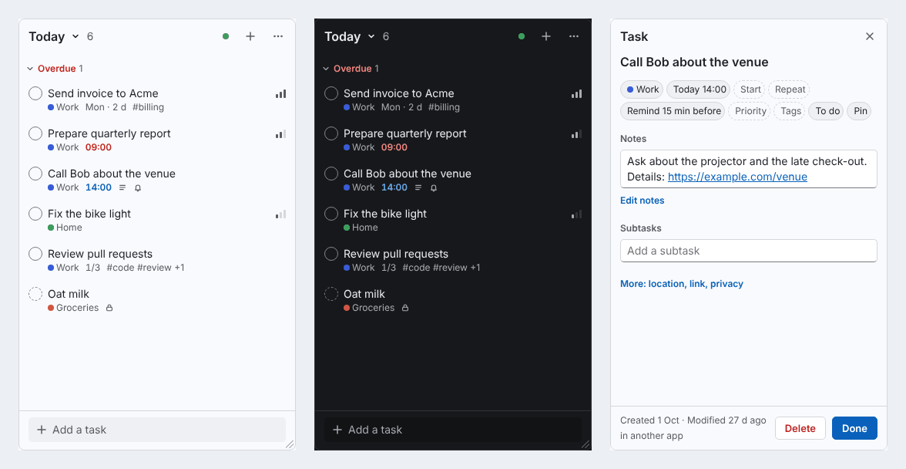

# desk-tasks

Your Nextcloud task lists as a small widget on the Windows desktop. It sits on the desktop
layer, always visible and never in the way. **Win+Alt+J** brings it to the front with full
keyboard control; **Esc** sends it back. It reads and writes your lists over CalDAV, next to
the Nextcloud Tasks app, tasks.org and Planify, and changes only what you changed.



> **Status:** early (0.1). The task core and UI are tested end to end against Nextcloud 35 in
> CI. The Windows techniques were proven on Windows 10 21H2 in a throwaway prototype (see
> [Verified on](#verified-on)); the app itself is new on Windows, so bug reports are welcome.

## Features

- **On the desktop, not in the way:** stays below your windows, stays visible on Show desktop
  (Win+D), no taskbar button. Win+Alt+J summons it, Win+Alt+N opens quick add; both can be
  changed.
- **Quick add** with a small grammar: `Call Bob tomorrow 14:00 #work !1 /Errands every monday
  // notes` (`#` tag, `!` priority, `/` list, `//` notes), in English and German (`morgen`,
  `nächste Woche`, `jeden Montag`).
- **Keyboard first:** `j`/`k`, `Space` to complete, `d` due date, `1`–`4` priority, `x` to
  select, `Ctrl+K` for everything, `?` for the full list. Single-key shortcuts can be turned off.
- **Views:** Today, Upcoming, All, each list, Trash; subtasks, your own order (drag and drop),
  repeating tasks, reminders as Windows notifications (Done / Snooze), sharing lists with other
  Nextcloud users.
- **Undo for every change**, for the whole session (`z` or Ctrl+Z).
- **Careful with your data:** edits are made in place in the task's iCalendar text, so
  properties other apps wrote survive byte for byte; every write is checked against what
  Nextcloud stored. If a change can't be confirmed, saving pauses and says why instead of
  retrying behind your back.
- Light and dark (follows Windows), high-contrast mode, screen-reader labels.

## Requirements

- Windows 10 (version 2004 or later) or Windows 11, with the Microsoft Edge WebView2 runtime
  (built in on current Windows).
- A Nextcloud with the Tasks app or any CalDAV task lists (tested with Nextcloud 35).
- Python 3.11 or later from python.org (3.15 recommended) and [uv](https://docs.astral.sh/uv/).

## Install

In PowerShell (not as administrator):

```powershell
winget install astral-sh.uv
winget install Python.Python.3.15
```

(If winget has no 3.15, take the installer from <https://www.python.org/downloads/windows/>.)

Open a new PowerShell window, then install the latest build:

```powershell
uv tool install --python-preference only-system --python 3.15 https://github.com/Mnikley/desk-tasks/releases/latest/download/desk_tasks-0.1.0-py3-none-any.whl
```

Start it with `desk-tasks` (if PowerShell doesn't find it, run `uv tool update-shell` and open a
new window). The first start connects your Nextcloud: **Log in in your
browser** (Nextcloud's Login Flow), or **Use an app password instead** (Nextcloud → Settings →
Security → Devices & sessions → Create new app password). It then asks which lists Today shows
and offers **Start with Windows**.

`--python-preference only-system` makes uv use the signed python.org interpreter rather than
its own download, so Smart App Control and SmartScreen stay quiet.

**Update:** quit desk-tasks from the tray, then run the same command with `--force --reinstall`
added.

**Uninstall:** turn off "Start with Windows" and log out in Settings (that asks Nextcloud to
revoke the app password), quit from the tray, then `uv tool uninstall desk-tasks`. To remove
everything, also delete `%LOCALAPPDATA%\desk-tasks` (settings, logs, the local copy of your
tasks).

## Privacy and security

- desk-tasks talks only to the Nextcloud you connect. No telemetry, no other servers.
- The app password is stored in Windows Credential Manager (`desk-tasks`), never in a file and
  never in the web view. One small Python function sends each request to your server's
  calendars; the page can't reach anything else (Content-Security-Policy `connect-src 'none'`).
- Logs (`%LOCALAPPDATA%\desk-tasks\logs`, at most 6 × 1 MB) contain no passwords and no task
  titles or notes. They do name your server, user name and lists (in task addresses).

See [SECURITY.md](SECURITY.md) for the design and how to report a vulnerability.

## Troubleshooting

- **A shortcut doesn't work:** desk-tasks says when another app holds it ("Win+Alt+J is used by
  another app"). Pick another one in Settings → Shortcuts. Ctrl+Alt combinations aren't offered
  (that's AltGr on many European keyboards).
- **No notifications:** check Windows Settings → System → Notifications (and Do not disturb).
  If Windows refuses a notification, desk-tasks shows a tray balloon instead.
- **"Saving is paused":** a change couldn't be confirmed (for example the connection dropped
  mid-save). Check the task in Nextcloud, then press Resume.
- **Anything else:** the log is `%LOCALAPPDATA%\desk-tasks\logs\desk-tasks.log`. Please attach
  its last lines to a [bug report](https://github.com/Mnikley/desk-tasks/issues/new/choose).

## Works with other apps

- **Nextcloud Tasks, tasks.org (DAVx⁵), Thunderbird:** shared fields are read and written the
  way they write them; unknown properties are kept.
- **Planify** regenerates tasks when it saves and drops start dates, unknown properties,
  "in progress", relative reminders and desk-tasks' "repeat from completion". desk-tasks can't
  prevent that; the task's footer says "Modified … in Planify" so you can tell why something
  changed.
- **tasks.org moves** delete and re-create a task with a new UID, so its fired reminders,
  snoozes and folds start fresh after such a move.
- All-day reminders count from 09:00 on the due day.

## How it works

- **TypeScript** (`web/`): the Preact UI and the task core: an in-place iCalendar editor, the
  CalDAV client, sync (sync-collection with confirmed deletions and a full reconcile every 30
  minutes), verified writes (If-Match, byte-exact read-back), the journal behind Undo. The local
  copy lives in IndexedDB.
- **Python** (`src/desk_tasks/`): the only trust boundary. `dav()` sends one request to your
  Nextcloud's calendars with the stored app password; Login Flow v2; settings; the event queue
  for the UI.
- **Windows shell** (`src/desk_tasks/win/`): a pywebview (WebView2) window on the desktop
  layer, global hotkeys, tray icon, notifications through WinRT, Start with Windows.

## Development

Development happens on Linux (the UI and core run in Chromium and against fake or Docker
servers); the Windows shell needs a Windows machine or CI's Windows runner.

```bash
bun install
uv sync
bun run build
```

| Command | What it runs |
|---|---|
| `bun run check` | Biome, `tsc`, `bun test`, ruff, ty (Linux and Windows), pytest |
| `bun run test:ui` | the built UI in Chromium against a fake CalDAV server (Playwright, axe-core) |
| `bun run test:nextcloud` | the core and the login flow against Nextcloud in Docker (`--image nextcloud:34-apache`, `--keep`) |
| `bun run screenshots [filter]` | every view and state, light and dark, 360 and 480 px, into `.screenshots/` |
| `bun run release` | the UI bundle, then `uv build` → `dist/desk_tasks-<version>-py3-none-any.whl` |

On Linux, `uv venv --system-site-packages && uv sync`, then `uv run desk-tasks` opens a plain
pywebview (GTK) window for trying things out. Tests never talk to a real Nextcloud: only to the
fake server (`web/test/fake-caldav.ts`) and the Docker container (`web/test/nextcloud/`).
[docs/windows-checklist.md](docs/windows-checklist.md) is the manual test on Windows.

See [CONTRIBUTING.md](CONTRIBUTING.md) before opening a pull request.

## Verified on

| Windows | Result | Notes |
|---|---|---|
| Windows 10 21H2 (19044.7807), Python 3.15.2, WebView2 156 | Prototype (not in this repository): desktop layer, Win+D, hotkeys, notifications, start without stealing focus, drag and resize, live theme, Explorer restart, IndexedDB across restarts | Rounded corners are Windows 11 only; square on Windows 10. |
| windows-latest (CI), Python 3.15 | Installs; Win32 and WinRT calls load; pytest | No desktop session: no visual checks. |

## License

[MIT](LICENSE). Third-party components and their licences:
[THIRD_PARTY_NOTICES.md](THIRD_PARTY_NOTICES.md).
